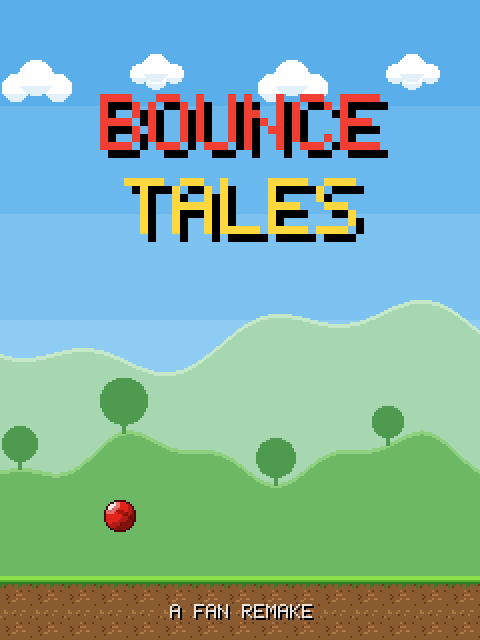
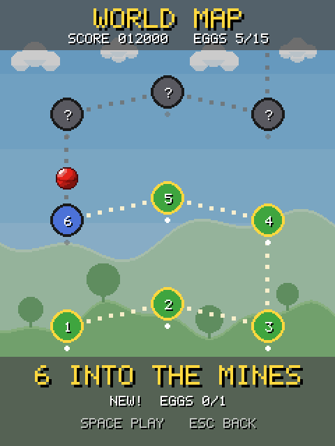
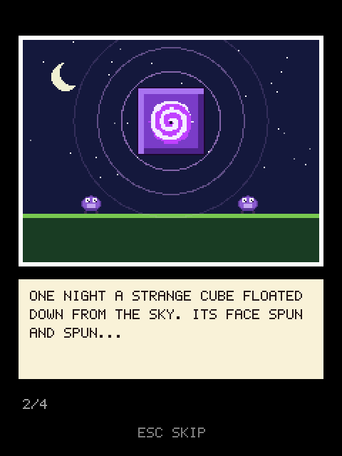
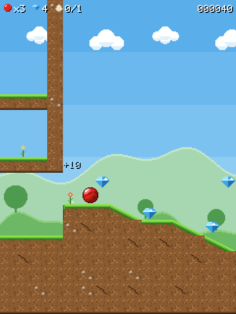
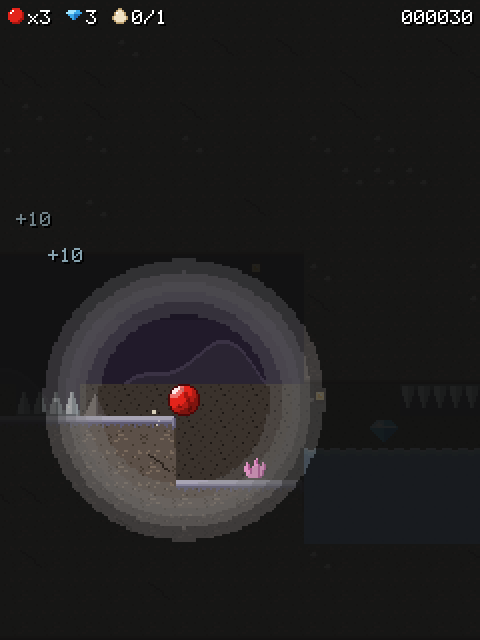
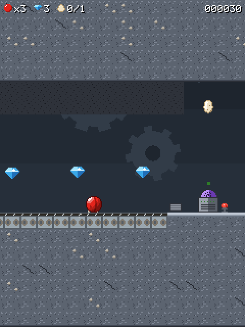
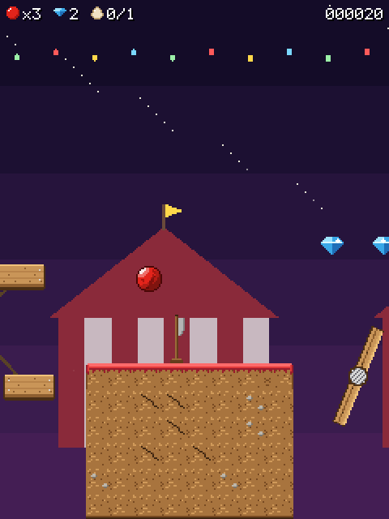
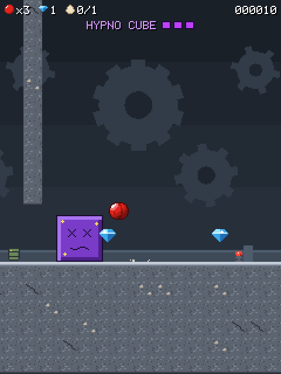

# bounce_tales

2008 Nokia game replicated in Rust using the [macroquad](https://macroquad.rs) game engine.

A fan remake of **Bounce Tales** (Rovio / Nokia, 2008) for Linux: the red
rubber ball rolls, bounces and transforms its way through 14 chapters to free
its friends from the Hypno Cube, plus a bonus chapter. All art, sound and
music are original and generated in code, and so are the levels (chapter 1 is
modelled on the original's layout). It is not affiliated with Rovio or Nokia.

<p>
  
  
  
  
</p>
<p>
  
  
  
  
</p>

## Features

- 14 chapters and a bonus chapter, each with a hidden egg, gems and checkpoints,
  on a world map where chapters unlock in order. The bonus chapter opens once
  you have found 10 eggs.
- Three forms: the bouncy red ball, the heavy **stone** (smashes cracked
  blocks, sinks in water, crushes enemies) and the floaty **balloon** (hold
  jump to rise).
- Switches and coloured doors, moving platforms and lifts, crates, seesaws,
  springs, catapults, cannons, fans, big wheels, spinners, conveyor belts,
  crumbling blocks, water, crushers and falling stalactites.
- Hypnotised creatures to free: walkers, flyers, jumpers, shooters and moles,
  hypno machines to smash, and the **Hypno Cube** boss.
- Forest, mine, factory and circus worlds, a dark cave, and comic-strip
  cutscenes.
- Chiptune sound effects and music synthesised at start-up.
- Your progress and settings are saved automatically.

## How to play

| Key | Action |
| --- | --- |
| Left / Right, A / D | Roll |
| Up, W, Space | Jump (hold to keep bouncing; as a balloon, hold to rise) |
| Esc, P | Pause / back |
| Enter, Space | Choose in menus |
| M | Sound on / off |
| - / = | Music volume |
| [ / ] | Effects volume |
| F11 | Fullscreen |
| F1 | Debug overlay |

Reach the exit gate in each chapter. Collect gems for points; a time bonus
rewards finishing under the par time, and finding a chapter's egg earns a big
bonus. Bounce on enemies to free them, and avoid spikes, pellets, crushers and
falling rocks. You have three balls; losing them all restarts the chapter.

## 1. Install Rust (rustup)

### Linux / macOS

```sh
curl --proto '=https' --tlsv1.2 -sSf https://sh.rustup.rs | sh
source "$HOME/.cargo/env"
```

### Windows

Download and run `rustup-init.exe` from <https://rustup.rs>.

### Verify

```sh
rustc --version
cargo --version
```

This project uses Rust edition 2024, so Rust 1.85 or newer is required. To update:

```sh
rustup update stable
```

### Linux system dependencies

macroquad needs a few system libraries on Linux:

```sh
# Debian / Ubuntu
sudo apt install pkg-config libx11-dev libxi-dev libgl1-mesa-dev libasound2-dev

# Fedora
sudo dnf install libX11-devel libXi-devel mesa-libGL-devel alsa-lib-devel
```

(Without `libasound2-dev` the build still links against the runtime ALSA
library if it is installed.)

## 2. Get the source

```sh
git clone https://github.com/jyotsanh/bounce_tales.git
cd bounce_tales
```

## 3. Build

```sh
# debug build
cargo build

# optimized release build
cargo build --release
```

## 4. Run

```sh
cargo run --release
```

The binary is also available after building at `target/release/bounce_tales`.
Every asset is compiled into it, so it can be copied anywhere and run on its
own.

### Command-line options

```text
--level <name>       Start in the given level (e.g. ch07)
--unlock-all         Make every level on the world map playable
--mute               Start with sound off
--scale <N>          Window scale factor (default 2)
--save <file>        Use this save file
--no-save            Don't read or write a save file
--frames <N>         Run N simulation frames, then exit
--replay <file>      Drive input from a replay file
--record <file>      Record keyboard input to a replay file on exit
--screenshot <png>   Save the game screen to a PNG on exit
--debug              Start with the debug overlay on
```

The save file lives in `~/.local/share/bounce_tales/save.ron`.

## Development

```sh
scripts/check.sh                     # fmt, clippy, all tests
cargo run --release -- --replay tests/replays/ch01_route.replay   # watch a recorded run
tools/levels/build.sh ch03           # rebuild a level from its generator
python3 tools/levels/recolor.py      # regenerate the recoloured tilesets
cargo run -p artgen                  # rebuild the sprite sheets from assets/art
cargo run --bin audio2wav            # write every sound and tune as WAV files
```

- The simulation is deterministic and runs without a window; `tests/replays`
  holds recorded routes through every chapter that the tests replay.
- Levels are Tiled maps in `assets/levels` (16 px tiles), generated from the
  scripts in `tools/levels`. Art is drawn as text in `assets/art`.
- `PLAN.md` is the 40-step build log.

## Credits

- Original game: **Bounce Tales** by Rovio Entertainment for Nokia (2008).
  This is an unofficial fan remake; no original assets are used.
- Chapter names and the chapter 1 layout follow the original, with the help of
  the MIT-licensed clone [abdellatifAhammad/bounce_tales](https://github.com/abdellatifAhammad/bounce_tales).
- Built with [macroquad](https://macroquad.rs) and [tiled](https://crates.io/crates/tiled).

## License

See [LICENSE](LICENSE).
